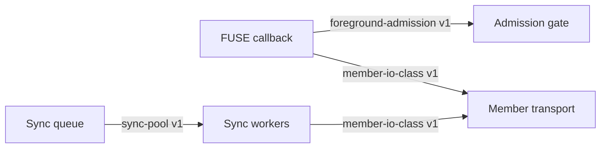

# Foreground responsiveness under bounded demand

State: draft on `66c640a`; Ted's 2026-11-10 ruling includes reads and browsing.

The review stop at `0631a73` is governed by the proposed
[`path-freshness-obligation`](../../contracts/path-freshness-obligation.md)
contract and huddle key `foreground-open-pin-ownership`. Two-member Event-gated
regression sources in `tests/test_fs_threading.py` are intentionally unrun
until root reviews that boundary and separately lifts the runtime hold.
The `cd116cc7` boundary review returned F1-F3 findings. Contract v2 maps F1
to the byte-mutation epoch, active-writer and no-replace publication rules;
F2 to durable cache-xattr debt plus conservative restart reprobe; and F3 to
per-member debts and generation checks. The threading test source adds
Event-gated write/truncate/create, two restart, and A-then-C completion
sequences. These are proposed acceptance tests, still unrun.
The `baa66ed` convergence review returned C1-C3 findings. Contract v3 adds a
path-wide publication revision that invalidates old B after changed A while
retaining per-member debts; keeps locally verifiable post-restart cached opens
in demand admission; and specifies validation during the write byte-to-DIRTY
window. Regression source adds an absent-final-path token check with debt and
revision assertions, a restarted warm-open/cold-copy saturation schedule, and
commit-entry, baseline and debt assertions for local mutations. Missing-cache
restart ambiguity now fails conservatively instead of choosing a holder by
rank. This correction is source-only and unrun.

## Intent and limits

Serve DESIGN's large-file streaming and offline-cache goals while background
sync and cold full-file copies are busy. A request waiting to browse metadata
or read bytes must have an admission path and, for SSH, a channel path.
Grow work with demand up to explicit caps. CPU load is diagnostic only: a
blocked member operation may use almost no CPU. Keep landed writes dirty or
synced, preserve returned bytes and remote member identity, and stop cleanly.

This is an opt-in mount feature so existing single-threaded mounts retain
their observed behavior. `max_foreground_operations` enables the multithreaded
FUSE loop and caps **active Python callbacks**, with protected capacity for
metadata, demand I/O, and remaining operations. It does not cap libfuse 2
native threads: blocked callbacks can still cause libfuse to create more.
The default foreground cap when opted in is 32, with one protected active
slot for each class and the rest shared; a configured cap from 3 to 128 is
allowed. Directory handles and listing use the metadata slot; warm cached
opens and reads use the demand slot; cold full-file opens use ordinary capacity.
A cached open whose entry disappears during freshness checking or eviction
drops its path/namespace locks, releases its demand slot, then waits for
ordinary admission to retry and fetch.
Freshness revalidation of a cached open still holds demand capacity while it
stats a member. At the minimum cap of 3, one slow member stat can delay other
demand callbacks until its I/O timeout; a larger cap allows shared demand
capacity. This is the cost of letting warm opens bypass cold copies.
At cap 3, each class has exactly one slot and progress still
depends on the active call finishing or its member timeout; admission does
not interrupt it. Explicit gate close cancels queued callbacks. During a
normal unmount libfuse joins handlers before calling `destroy`, so queued
callbacks may drain before `destroy` closes the gate; unmount latency depends
on active member operations and their timeouts. Sync may grow from its configured minimum up to a separately
configured maximum, capped at 8 with SSH members or 32 local-only. Neither
pool may silently expand without its configured limit.

No live profile changes, production mount, real cache inspection, deploy, or
claim of a hard process-thread bound is in scope. No new CPU-load policy or
streaming range pipeline is needed for this mission.

## Firewalled entities and boundaries

The FUSE callback keeps the exact operation and return value; the gate only
decides when it may run. Full cache copies are bulk for the duration of the
copy, even when started by a foreground open. Metadata listing and demand
range reads retain interactive classification. The SSH pool's existing
interactive channel reserve applies. The sync queue remains durable across
stop/restart; no task is dropped because worker growth or shutdown raced it.

## Milestones and acceptance

1. Tracer: an executable cold-open/listing classification test fails on the
   old head, then passes without changing bytes. It must expose deferred
   `readdir` generator execution as well as full-copy classification.
2. Foreground gate: a synthetic red test first shows cold opens occupying
   callback capacity that browsing and demand reads need. Then saturation
   proves metadata, demand read, and ordinary work each progress when a
   class slot becomes free; cap, FIFO within class, cancellation, close,
   and no lost callback or leaked slot. Assert exact bytes and unchanged
   exceptions. Use FUSE callbacks directly, without a manual mount. Native
   libfuse thread growth remains outside this test's claim.
3. Sync demand growth: reuse #167's reviewed logic where compatible with
   current master. Prove cap, idle retirement, stop/restart, queue
   preservation and partial startup cleanup. Keep display labels separate
   from stable `remote0` identity and retain `UpdateHostKeys=no`.
4. On a clean pushed head run CLI build and `scripts/run-gates.sh` (all four
   gates), formal council to fixpoint and independent lead review. Root owns
   acceptance and eventual scripted normal merge; no lane here merges.

## Stop conditions

Escalate a product tradeoff, live-data requirement, keys/money, unresolved
third approach failure, or a change to a published boundary. If fleet gate
capacity is unavailable, continue source and synthetic work and identify
the exact blocked gate. The separate #167 draft remains intact; record its
succession explicitly before this PR can be accepted.

