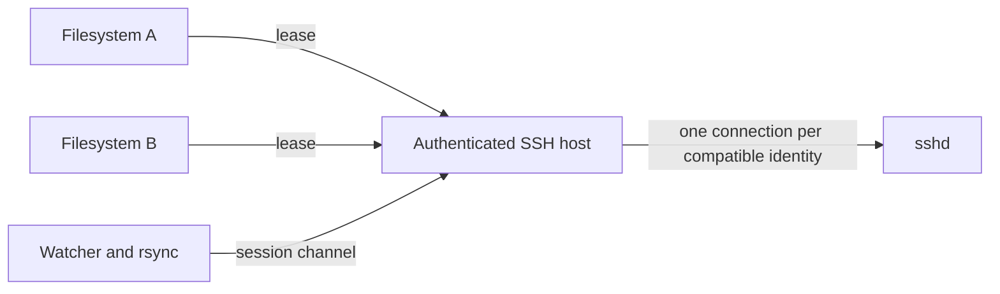
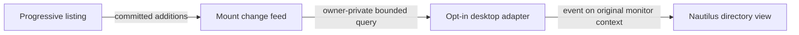

# Shared host connections and live Nautilus listings

Proposed against the progressive-listing build at `0e874bd`. The two changes can ship independently. Tests use synthetic filesystem roots.

## One connection with several filesystem roots

A mount with three roots reached through the same SSH login should authenticate once and keep one TCP connection during normal service. Each root still appears as a separate Storage member. Two roots can have the same relative filename and unrelated contents, free space, permissions and availability. A host can serve a healthy filesystem alongside an inaccessible one. Transport loss affects all users of that transport.

The mount constructs the host registry from existing member configuration. Existing profile syntax, member ordering, replication identities and persisted cache metadata remain compatible. Host identity and connection lifetime belong to the transport layer. Each filesystem adapter owns path translation, its root probe, and the result of each filesystem operation. Scheduling consumes the host's actual channel budget once. See the [host transport contract](../../contracts/host-filesystems.md).

First, share the SFTP and metadata transport used by SSH and rsync filesystem adapters. Second, offer a mount-wide OpenSSH opt-in (`ssh_transport = "openssh"`) for mounts that need one connection for SFTP, watching and rsync together. The mixed-protocol transport is experimental until this surface is implemented and verified. In this mode OpenSSH owns the host identity, authentication and routing for every channel. A failed session must not silently fall back to another TCP connection. Preserve the existing choice of credentials and route for profiles that use the default transport. Measure the connection count at the server for each stage. The deployed baseline uses a separate OpenSSH master for those subprocesses. That distinction matters when reporting results. A startup capability probe and a post-fork serving connection may occur in succession. A pre-fork SSH client must never be used by the child.

**Release evidence.** On one synthetic sshd put three roots behind one identity, give each a distinct sentinel, and start reads concurrently. Count authenticated connections on the server while channels are active. Read another root while bulk requests are queued and while a bulk transfer moves bytes. Run the latter under matched fixture and network conditions against separate per-member connections. Record a latency allowance for those conditions before the run, compare foreground latency distributions, and stop rollout if the allowance is exceeded. Take one root offline, close a member with a sibling in flight, and repeat after transport recovery. Confirm that a failed mux-only attachment cannot open a replacement connection.

| Traffic during the server-side count | Expected steady-state connections |
| --- | --- |
| Default transport, shared SFTP for three compatible roots | 1 |
| Same roots with watcher and rsync on one separate OpenSSH master | 2 |
| OpenSSH opt-in with mixed SFTP, watcher and rsync | 1 |
| OpenSSH mixed case with a second active identity | 2 |

Report startup probes and transient reconnect connections separately. Stop if grouping weakens host verification, mixes credentials, or lets one root's path or availability leak into another.

## Late additions in an open Nautilus directory

With progressive listings enabled, a cold directory can return as soon as one member answers. A slower member may subsequently contribute a new child. Someone already looking at that directory should see the row appear, with the same `file://` location and without refreshing, navigating or switching focus. On a threaded FUSE mount, a pending listing in another tab must allow updates here to proceed.

Stock Nautilus 46.4 on the tested Linux stack received no GIO event from FUSE entry invalidation alone. A private process-scoped adapter emitted a `CREATED` event on the directory's own GIO monitor and the new row appeared. This is the starting point for an opt-in adapter. The first implementation targets additions from progressive listings. Ordinary filesystem writes keep their normal kernel notification path. See the [original capability experiment](https://github.com/tedks/storage/pull/193) and [desktop additions contract](../../contracts/desktop-progressive-additions.md).

**First runnable slice.** Use a private D-Bus session bus, temporary home and XDG directories, and an isolated display or compositor. Check that the Nautilus window belongs to the fixture process on its own bus before interacting with it. Load the opt-in adapter only in that process and subscribe the exact synthetic directory monitor. Use the window's AT-SPI rows or a documented equivalent view-level probe. Release the held member only after the first row appears and a lookup of the held child reports `ENOENT`. Within five seconds of release, the same view should render the second row. In the disabled control, the row stays absent for the same interval, then appears after manual refresh. Keep an unrelated directory open to detect misdelivery. In a separate threaded-mode run, hold a member listing in another tab while the first view receives its new row, and verify that the held listing is still pending. Capture aggregate pass/fail evidence. A client harness proves the part of the chain it actually exercises. The visible-row check in Nautilus is the acceptance test for the desktop claim.

**Before general rollout.** Cover the initial enumeration/subscription race, directory navigation, multiple windows, bounded overflow, disconnect and remount, and late callbacks during shutdown. Provide an explicit installation and removal path for tested Nautilus/GIO versions. Measure idle and busy overhead. Extend separately to removals, attribute changes and replacement using the [desktop changes contract](../../contracts/desktop-listing-changes.md). A partial member listing alone cannot establish deletion. Stop if delivery requires a fake filesystem mutation, an untargeted window reload, inspection of real filenames or logs, or changes to user data.
