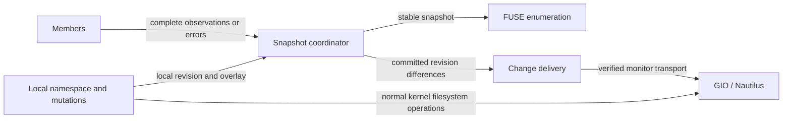

# Cached union listings and live desktop updates

Status: proposed design, 2026-11-12. Owner: Storage root. No implementation,
release acceptance or deployment is implied. Source baseline: published
66c640aec005feccd0bd585f3355295c3bb772ba; deployed application findings refer to
accepted 81793ac27b70f82c231bf607b55e775d2b905974. This does not resolve the #170
merge-gate incident or depend on unaccepted #171/#175 behavior.

## Intent and assumptions

Show a useful union quickly, then update an already-open Nautilus directory
when the union changes. Ted's reachable-but-empty chunk1 contributes no paths;
it must not hide chunk0's observed paths. This is a requirement to prove, not
a claim that the field audit reproduced a missing-name regression.
Freshness scheduling is time based, with watcher hints accelerating it. Directory mtime alone cannot certify freshness.

Assume one process owns each cache root; members may be slow, absent, empty,
or modified by other programs. Listings are not atomic across members.
Names and remote metadata are untrusted. Local dirty files must remain usable.
A listing describes discoverable names, not proof that file contents are fresh.
No filesystem probe or measurement is authorized by this document.

“Cache the design” here means save this proposal in version control. The
runtime design starts with bounded in-memory listing caches. Persisting these
snapshots across daemon restarts is not required and must not silently turn an
old snapshot into fresh evidence.

## Goals and non-goals

- Return an existing merged snapshot without waiting for remote I/O.
- Refresh each member independently and publish a versioned union; one slow
  member must not withhold completed results from healthy members.
- Distinguish successful empty results, incomplete enumeration and errors.
- Deliver added, removed and changed observations to an open desktop view,
  including metadata changes to an existing file.
- Preserve local writes, conflict presentation and existing content safety.
- Bound refresh work, memory, retries and event delivery; recover from missed
  events with time-based reconciliation.

Not included: strong replica consistency, automatic conflict resolution,
remote-content downloads during listing, new content-cache durability,
changing writeback semantics, automatic cache deletion/rebalancing, kernel or
GNOME patches, a wholesale FUSE binding migration, or live mount rollout.
New names do not justify prefetching their file contents or sniffing MIME data.

## Entities and boundaries

| Entity / owner | Responsibility | Published contract |
|---|---|---|
| Member observation / backend owner | Complete per-member directory observations and explicit failures | [Union snapshots](../../contracts/union-listing-snapshots.md) |
| Snapshot coordinator / namespace owner | Merge observations with local namespace; schedule bounded refresh; publish revisions | [Union snapshots](../../contracts/union-listing-snapshots.md) |
| Change delivery / desktop integration owner | Translate committed revision differences into client invalidations/events | [Desktop changes](../../contracts/desktop-listing-changes.md) |
| Local mutation / filesystem owner | Maintain authoritative local write/rename/unlink state; invalidate older refresh publication | [Desktop changes](../../contracts/desktop-listing-changes.md) |

These are responsibilities, not a requirement for new services or four teams.
Start with existing modules and one implementation owner after feasibility.

## Cache and refresh behavior

A cached directory returns an immutable snapshot immediately. Staleness
schedules one refresh per directory/member, rather than making every caller
launch a scan. Successful observations replace that member's prior set,
including replacement with the empty set. Failed or interrupted scans do not
replace it with an invented empty set. Retained last-known observations remain
explicitly stale; local cached/dirty entries remain under existing namespace
policy. This proposal never deletes file bytes because a listing omitted them.

Completed member results may publish successive union revisions. A response
must be fenced against newer scans and changes to member configuration or
directory identity. Merge a valid observation with the current local overlay,
using per-name mutation revisions: do not discard the entire member result
because an unrelated local name changed. Preserve newer local creates,
renames and deletion tombstones under the existing namespace contract, while
allowing untouched remote additions to publish during continuous local churn.
If that merge cannot be made safe, stop at the mutation boundary; do not fall
back to unbounded whole-directory retries. Partial pages are staging state,
not authoritative absence. Keep existing conflict/virtual-name policy and stable member IDs.

Each FUSE directory handle enumerates one revision with stable offsets. Do not
append late results behind an EOF already delivered, or change the meaning of
an offset midway through a scan. Later revisions require a new enumeration
triggered by a real client notification. The current high-level binding may
provide buffering/offset handling itself; audit that path before adding any
duplicate buffering. Pinned snapshots count against resource limits.
A cold directory waits a bounded interval for member observations; with no successful observation and no cache,
return an explicit unavailable error, never a successful empty directory.
If only some members finish, the candidate snapshot is partial. In particular,
empty A plus failed/slow B does not certify an empty union. POSIX readdir has
no partial-result flag. Whether to expose such a candidate, wait within a
bound, or return a retryable error is a product decision recorded in
`oq-listing-cold-partial-result`; no cold-partial public behavior is selected
by this spec. Any permitted partial publication must keep internal status
partial and may not claim that a future automatic update is guaranteed
unless the client transport has been proven. Cached known names remain a
separate stale-first case. This policy blocks cold-partial integration, not
the internal union/cache tracer.

Use monotonic time for in-process TTLs. Watcher hints invalidate freshness but
never disable periodic reconciliation: disconnect, overflow and missed events
must not make a directory permanently fresh. A directory mtime check may save
work as a hint, but equal mtime does not extend freshness indefinitely and
cannot detect writes to existing children. The current 60-second TTL and
3,600-second stale policy are reference values, not newly ratified bounds.

Active monitoring needs explicit bounded subscription or recent-use tracking.
FUSE readdir/releasedir does not tell us whether Nautilus still watches a view.
The feasibility result must say how active directories are known and how they
expire. Refresh admission, per-member deadlines, active-directory limits,
cache byte/entry limits, retry backoff and event-coalescing limits must be
specified and tested before implementation acceptance. No whole-tree polling.
Numeric UX bounds and the stale/error presentation decision remain in
`oq-listing-stale-serve-dir-mtime`; prototype measurements inform that ruling.

## Existing-file writes and copy progress

A copy through the mounted pathname uses local filesystem operations. Those
can generate kernel change events, and Nautilus also manages its own copy
operation. Seeing an entry appear or its size change during a copy is therefore
compatible with the usual local monitoring path. It is not evidence that
remote-member edits reach the same client. The exact cause of Ted's observed
updates has not been measured.

A write changes the file's metadata/content; it need not change its parent's
mtime. Directory listing refresh alone is insufficient to notice an overwrite
under the same name. Remote watcher events or bounded child-metadata checks
must cover existing names in an actively observed directory. Size/mtime are
hints, not byte-equality proofs; same-size, same-timestamp changes need a
stronger change token/event or the content path's separate validation policy.
This design promises detected-change delivery, not detection of every hidden
remote overwrite with metadata-only polling.

Local writes update local visible metadata and dirty state under the existing
filesystem mutation contract. Background results cannot overwrite that state,
truncate a copying file, replace its inode under an open writer, mark it clean,
or select remote bytes because a newer listing arrived. An observed remote
change invalidates clean metadata/content freshness through the existing safe
path; if no safe invalidation exists for an open file, preserve its handle and
record a recheck/conflict instead of forcing replacement. Changed bytes are
fetched only by the content path, not by desktop change delivery.

Coalesce notifications during long copies, but deliver the latest observable
size/mtime and a final update after the last writer closes. A close hint does
not mean remote sync or durability succeeded. No duplicate upload is caused by
notifications. Atomic replacement by temp-file rename is a namespace event,
not an in-place write; test both. Do not promise per-write UI repaint or that a
thumbnailer will reread contents immediately.

## Desktop notification feasibility

Nautilus monitors directories through GIO. Linux's local GIO monitor commonly
uses inotify, which observes filesystem operations on that client. Remote
changes behind a network mount do not automatically generate those events.
Refreshing Storage's internal caches is consequently not enough.

Current fusepy/libfuse2 high-level integration exposes no low-level inode
notification handle. Even low-level entry invalidation is not a universal
remote CREATE/CHANGE event: deletion notification has narrower documented
semantics. Do not claim that switching bindings alone solves live Nautilus.
Keep attr_timeout=0 unless a separately proven content-safe change replaces it.

The first milestone is a scratch capability experiment, not a production
rewrite. Test the installed supported kernel/libfuse/GIO versions and record
whether remote-origin add/remove/overwrite can cause the local GIO monitor
and a normal Nautilus file:// view to update. No touches, fake writes,
re-mounts, focus changes, F5 or periodic UI reopening may stand in for delivery.
Use a second producer, not Nautilus's own copy operation, for the positive test.

If existing FUSE cannot deliver the necessary notifications, report that as
unsupported. A GIO/GVFS integration could supply its own monitor, but would
need a separately ruled client/URI/deployment change and demonstrated routing
for the actual opened URI. Polling Storage internally is not that routing.
Do not implement an unbounded compatibility layer to rescue a failed premise.

## Milestones and acceptance

1. **Spec:** freeze this proposal and contracts; formal council before merge.
   No runtime code, mounts, BUILD edits or field probes in this phase.
2. **Capability tracer:** separately assigned scratch-only experiment proves
   the actual event path, or closes it as unsupported with versioned evidence.
3. **Snapshot tracer:** deterministic synthetic members prove empty/error
   separation, fast cached return, partial/cold union, publication fencing,
   bounded workers and immutable readdir offsets. Mutation-disable controls
   must demonstrate that the tests detect the promised failure.
4. **Existing-file tracer:** changed remote metadata reaches the consumer;
   local ongoing copy and remote refresh race without losing bytes/DIRTY;
   temp rename, delete/recreate, dropped watcher, coalescing and reconnect run.
5. **Integration:** snapshot/cache improvements can ship independently after
   their numeric and cold-partial policy is settled and safety proven; report
   live desktop updates unsupported if transport is unsupported. Combining
   change delivery requires its capability proof. Run applicable exact-head
   gates, CLI build, formal council and lead review; normal gated merge. Deployment is a separate
   explicit action with rollback, not an implication of spec acceptance.

An unsupported client-event transport stops only the change-delivery slice,
not independent snapshot correctness or stale-first work. Stop the affected
slice on an unsafe content/namespace invalidation dependency, unbounded remote
work, changes to URI/client/kernel scope, or three unsuccessful attempts at
the same approach. Escalate the specific boundary; do not import PR171 wholesale or weaken freshness claims.

## Evidence and interpretations

- Ted: reachable empty chunk1 contributes no names; union all results; desired
  stale-first browsing plus updates to an open Nautilus view. No cache purge.
- PR177 report at 01386e6: slow first-observed readdir and warm per-entry cost;
  no missing entries reproduced; no attribution of latency to chunk1.
- [Nautilus monitor implementation](https://github.com/GNOME/nautilus/blob/master/src/nautilus-monitor.c):
  GIO directory monitoring and changed-event handling.
- [GIO monitor event API](https://docs.gtk.org/gio/enum.FileMonitorEvent.html):
  change and completion hints, not synchronization receipts.
- [Linux inotify limitations](https://man7.org/linux/man-pages/man7/inotify.7.html):
  client filesystem operations versus remote network events.
- [libfuse notification API](https://libfuse.github.io/doxygen/fuse__lowlevel_8h.html):
  distinguish invalidation from event delivery. These upstream references are
  background evidence, not proof of the versions installed on splinter1.

Interpretations promote into this document and both contracts. Open numeric
and stale-visibility policy remains in `oq-listing-stale-serve-dir-mtime`.
Cold-partial exposure is tracked separately in `oq-listing-cold-partial-result`.
Transport feasibility is engineering evidence to obtain, not a presumed
product ruling to ask Ted to make without results.
