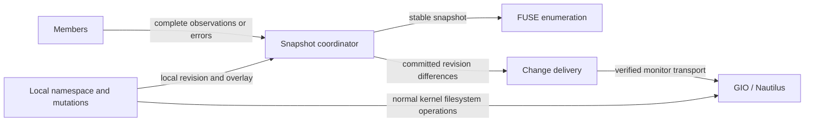

# Cached union listings and live desktop updates

Status: proposed design, 2026-11-12; cold-partial ruling folded in
2026-11-17. Owner: Storage root. No implementation, release acceptance or
deployment is implied. Source baseline: master
0953369de47a7e9b46a0edca8facfee99d6bb490 (code as of 5f3dbb3; #177 added only
the field report); deployed application findings refer
to accepted 81793ac27b70f82c231bf607b55e775d2b905974. #175 (interactive SFTP
reserve for listings) is on that baseline; nothing here depends on unmerged
#171 behavior or resolves the #170 merge-gate incident.

## Intent and assumptions

Show a useful union quickly, then update an already-open Nautilus directory
when the union changes. Ted's reachable-but-empty chunk1 contributes no paths;
it must not hide chunk0's observed paths. This is a requirement to prove, not
a claim that the field audit reproduced a missing-name regression.
Freshness scheduling is time based, with watcher hints accelerating it. Directory mtime alone cannot certify freshness.

Assume one process owns each cache root; members may be slow, absent, empty,
or modified by other programs. Listings are not atomic across members.
Names and remote metadata are untrusted. Local dirty files must remain usable.
A listing describes discoverable names, not proof that file contents are fresh.
No filesystem probe or measurement is authorized by this document.

“Cache the design” here means save this proposal in version control. The
runtime design starts with bounded in-memory listing caches. Persisting these
snapshots across daemon restarts is not required and must not silently turn an
old snapshot into fresh evidence.

## Goals and non-goals

- Return an existing merged snapshot without waiting for remote I/O.
- Refresh each member independently and publish a versioned union; one slow
  member must not withhold completed results from healthy members.
- Distinguish successful empty results, incomplete enumeration and errors.
- Deliver added, removed and changed observations to an open desktop view,
  including metadata changes to an existing file.
- Preserve local writes, conflict presentation and existing content safety.
- Bound refresh work, memory, retries and event delivery; recover from missed
  events with time-based reconciliation.

Not included: strong replica consistency, automatic conflict resolution,
remote-content downloads during listing, new content-cache durability,
changing writeback semantics, automatic cache deletion/rebalancing, kernel or
GNOME patches, a wholesale FUSE binding migration, or live mount rollout.
New names do not justify prefetching their file contents or sniffing MIME data.

## Entities and boundaries

| Entity / owner | Responsibility | Published contract |
|---|---|---|
| Member observation / backend owner | Complete per-member directory observations and explicit failures | [Union snapshots](../../contracts/union-listing-snapshots.md) |
| Snapshot coordinator / namespace owner | Merge observations with local namespace; schedule bounded refresh; publish revisions | [Union snapshots](../../contracts/union-listing-snapshots.md) |
| Change delivery / desktop integration owner | Translate committed revision differences into client invalidations/events | [Desktop changes](../../contracts/desktop-listing-changes.md) |
| Local mutation / filesystem owner | Maintain authoritative local write/rename/unlink state; invalidate older refresh publication | [Desktop changes](../../contracts/desktop-listing-changes.md) |

These are responsibilities, not a requirement for new services or four teams.
Start with existing modules and one implementation owner after feasibility.

## Cache and refresh behavior

A cached directory returns an immutable snapshot immediately. Staleness
schedules one refresh per directory/member, rather than making every caller
launch a scan. Successful observations replace that member's prior set,
including replacement with the empty set. Failed or interrupted scans do not
replace it with an invented empty set. Retained last-known observations remain
explicitly stale; local cached/dirty entries remain under existing namespace
policy. This proposal never deletes file bytes because a listing omitted them.

Completed member results may publish successive union revisions. A response
must be fenced against newer scans and changes to member configuration or
directory identity. Merge a valid observation with the current local overlay,
using per-name mutation revisions: do not discard the entire member result
because an unrelated local name changed. Preserve newer local creates,
renames and deletion tombstones under the existing namespace contract, while
allowing untouched remote additions to publish during continuous local churn.
If that merge cannot be made safe, stop at the mutation boundary; do not fall
back to unbounded whole-directory retries. Partial pages are staging state,
not authoritative absence. Keep existing conflict/virtual-name policy and stable member IDs.

Each FUSE directory handle enumerates one revision with stable offsets. Do not
append late results behind an EOF already delivered, or change the meaning of
an offset midway through a scan. A later explicit opendir or manual refresh
can enumerate a newer revision. Automatically updating an already-open view
requires a new enumeration triggered by a proven client notification.
The current high-level binding may
provide buffering/offset handling itself; audit that path before adding any
duplicate buffering. Pinned snapshots count against resource limits.

### Cold listing with an unavailable member (ruled 2026-11-17)

A cold directory (no listing snapshot and no retained member observation)
waits a bounded interval for member observations. The same wait bound applies
to every foreground listing without a servable snapshot, including an
expired directory whose members still have retained observations; after
the bound, the rules below decide what is served. Ted ruled the case where
at least one member succeeds and another fails or times out: return the
union that is available, even when it is empty, and log each missing member.
No partial-result UI flag and no working notification transport are
required for this. The ruling accepts the known risk: POSIX readdir cannot
mark a result partial, so a normal client shows it as complete, and names
held only by B stay hidden until a later enumeration after B answers. The
warning log is the operator's signal. Concretely:

- The public result is the union of the successful members' observations
  and the local namespace, under the existing conflict/virtual-name policy.
  Example: A is reachable and empty, B is unavailable, the local cache holds
  nothing: readdir succeeds with only `.` and `..`. If the local cache holds
  names (cached or dirty files), they are listed.
- Internally the snapshot stays partial: per-member status records B as
  unavailable/timeout/cancelled/unverified-root, distinct from A's
  successful empty observation. "Never fresh" means a per-member
  completeness status, separate from the serving TTL: the partial snapshot is
  never reported complete or fresh for B, never becomes a confirmed-empty
  observation for B, and never removes or hides a local name. It does not
  change the serving schedule (the snapshot ages through fresh, stale and
  expired as any other) and it does not trigger a refresh per access.
  Negative lookups keep the `oq-listing-negative-lookup` ruling unchanged:
  ENOENT comes from a fresh listing, a member whose listing failed already
  withholds that shortcut (`_walk_listing_locked`), and a member reporting
  itself unavailable is skipped as today. This spec does not change it.
  B's later successful observation (including an empty one) replaces only
  B's set. A member whose enumeration fails midway counts as missing: its
  staged pages are not published (assumption: a partial page is not a
  member observation). Later readdirs serve the partial snapshot stale-first.
  B is retried on a schedule of its own, not by the serving TTL (which is
  infinite on a mount whose members all have watchers) and not per readdir:
  a background refresh of B for that directory under the interim backoff
  below, while the directory stays in the listing cache.
- Each missing member is logged at warning level with its stable member ID,
  the failure class and the directory, under the existing logging policy;
  repeats for the same member are rate limited or coalesced so an outage
  cannot flood the log. Debug-only logging does not satisfy the ruling.
  This applies to every listing that serves without a member, warm refreshes
  that keep retained names included, not only cold ones.
- The result does not promise that B's names will appear in an open view
  later; they appear at the next enumeration of a newer revision. Automatic
  updates of an open view remain the separate change-delivery slice.

"Missing" means any non-success member result: failed, timed out,
cancelled (including by shutdown) or root unverified (below). A missing
member never counts as a successful empty observation.

A failed disk can look empty. Today `LocalBackend.listdir` returns `[]` for a
path that does not exist, and `SSHBackend.listdir` maps `FileNotFoundError`
to `[]`; neither rechecks that the member root is still the configured
storage once the backend is constructed. A member whose disk died and left an
empty mountpoint would therefore report successful-empty: nothing is logged,
and on a warm directory its retained names are replaced by an empty set.
The member-observation owner must tell "directory absent under a verified
member root" apart from "member root missing or replaced". When the check
runs:

- A local member checks its root (one local `stat`, uncached) after each
  listing read, so the check postdates the observation.
- A remote member's non-empty observation that removes no retained names
  may rely on a verification cached for at most the interim root recheck
  interval below.
- A remote member's empty or ENOENT observation, cold or warm, and any
  observation that would remove names from its retained set, is accepted
  only after a root verification that started after the observation was
  read; until then it is a missing member, logged as such. Verifications
  coalesce per member: one verification covers every observation of that
  member read before it started, so a burst of empty listings or deletions
  costs one probe, and probes are admitted like other member work. There is
  no silent window: a failed disk is either verified missing or the listing
  waits (within the whole-request deadline) for the verification.
- ENOENT for a subdirectory under a verified root stays successful-empty
  once verified (sparse placement depends on it); the cost on sparse
  remote directories is the coalesced probe.

Mechanisms: a local member compares the root's device (`filesystem_identity`,
`st_dev`) with the expected identity. An SSH or rsync member, whose SFTP
attributes carry no device id, uses a root marker file read over SFTP or a
remote `stat -c %d`. Today's `SSHBackend.filesystem_identity` opens a fresh
SSH connection per call and is written to run before FUSE's daemonizing
fork; reusing it after the fork, or running the stat as an exec on the
pooled transport, is a tracer decision. No variant, including a marker
read over SFTP, uses the reserved interactive SFTP channel; whether it takes
a bulk-class lease or a connection of its own is also a tracer decision. A
probe that cannot complete within the whole-request deadline (for example
queued behind bulk copies) makes the member missing for that listing,
logged, never empty. A probe that returns `None` or fails, for
a member with an expected identity, is an unverified root, not "no
information" (the current `filesystem_identity` contract treats `None` as
no information; this check must not). An identity recorded only at startup cannot catch
a disk already missing at mount time, so the expected identity (or marker)
comes from member configuration or a marker written with the member; with
neither, the limitation is reported, not hidden. An unverified root is a
missing member with its own failure class: logged, retained names kept,
never confirmed absence.

The no-success case stays narrow and explicit. It applies only when every
configured member is missing for this listing, no member has a
retained last-known observation of the directory, and the local namespace
contributes no names. Then readdir returns an explicit unavailable error,
never a successful empty directory. If the local namespace does contribute
names in that state, they are served and every member is logged missing
(this follows the ruling's "preserve local names": local dirty files stay
discoverable during a total outage). A single-member mount whose one member
fails follows these all-failed rules, not the partial case. A member with a
retained observation whose snapshot expired is not cold: when every
member fails, the retained last-known names (with local names) are served
as stale, not an error.

Cached known names remain the separate stale-first case (see the start of
this section): a directory
with a snapshot serves it without waiting, and a failed refresh retains each
member's last-known names as stale, as before.

Current code (master 5f3dbb3, `NamespaceService._list_members`) already
serves the available union when some members fail, but differs from this
section in ways the snapshot tracer must close: a missing member is logged
only at debug level (a background refresh that gives up on a member logs a
warning in `_abandon_listing`; a foreground failure does not); when every member fails and nothing is cached it
returns a successful empty listing; a partial listing carries no
per-member completeness status (its serving timestamp is correct and stays
as it is); a missing or replaced member
root lists as successful-empty (above); and a foreground cold listing has no
deadline of its own (`deadline=None`), bounded only by each member's
transport timeout, and a local member has none, so a hung local disk blocks
the listing without bound.

Interim bounds. The cold-partial slice (warning logs, the narrow error,
per-member completeness status, the root check) does not wait for the
numeric ruling. Until `oq-listing-stale-serve-dir-mtime` sets numbers, it
uses these interim values, each from existing defaults:

- Foreground deadline: one whole-request deadline of `refresh_member_timeout`
  (60 s) for a listing without a servable snapshot. Members are listed
  concurrently, so it bounds the request rather than each member in turn.
  A member still running at the deadline is missing, and its worker is
  abandoned and accounted for as background refresh already does. A local
  member therefore also needs an abandonable worker, since it has no
  transport timeout.
- Missing-member retry: the first retry after 60 s, doubling to a cap of
  `listing_max_stale` (3,600 s), reset when that member next succeeds on
  any listing. This holds even when the serving TTL is infinite (watchers
  on every member) or shorter. A retry relists the directory as today's
  background refresh does; the tracer may narrow it to the missing member.
- Queued refreshes: the existing per-directory dedup
  (`_background_refreshes`, one queued or running refresh per directory)
  on the existing background executor, so at most one per cached
  directory.
- Root recheck interval for remote members: at most 60 s (the default
  fresh window), never unbounded. Local members do not cache it.
- Admission: the existing single listing worker per member. A member with a
  listing already hung (`_hung_listings`) is treated as missing by
  foreground listings too, instead of queueing behind it.
- Active directories and cache size: the existing listing cache limit
  (`listing_limit`, 4,096 directories, least recently used). Retries run only
  for directories still in it.

- Snapshot size: this slice adds only per-member status (a constant per
  member per cached directory) and pins no new revisions; entries stay
  bounded as today by the listing cache limit and directory contents. It
  adds no snapshot byte or entry limit, so it must not introduce revision
  pinning, history or any other per-entry state.

These satisfy the contract's resource policy for this slice only, as the
contract's narrowed requirement states. The numeric ruling replaces the
values; it does not reopen the behavior. Other snapshot work (revisions,
pinned handles and history, active-directory tracking for change delivery,
refresh admission beyond one worker per member) still needs snapshot
byte/entry limits and the numbers.

### Freshness and refresh limits

Use monotonic time for in-process TTLs. Watcher hints invalidate freshness but
never disable periodic reconciliation: disconnect, overflow and missed events
must not make a directory permanently fresh. A directory mtime check may save
work as a hint, but equal mtime does not extend freshness indefinitely and
cannot detect writes to existing children. The current 60-second TTL and
3,600-second stale policy are reference values, not newly ratified bounds.

Active monitoring needs explicit bounded subscription or recent-use tracking.
FUSE readdir/releasedir does not tell us whether Nautilus still watches a view.
The feasibility result must say how active directories are known and how they
expire. Refresh admission, per-member deadlines, active-directory limits,
cache byte/entry limits, retry backoff and event-coalescing limits must be
specified and tested before implementation acceptance. No whole-tree polling.
Numeric UX bounds and the stale/error presentation decision remain in
`oq-listing-stale-serve-dir-mtime`; prototype measurements inform that ruling.

## Existing-file writes and copy progress

A copy through the mounted pathname uses local filesystem operations. Those
can generate kernel change events, and Nautilus also manages its own copy
operation. Seeing an entry appear or its size change during a copy is therefore
compatible with the usual local monitoring path. It is not evidence that
remote-member edits reach the same client. The exact cause of Ted's observed
updates has not been measured.

A write changes the file's metadata/content; it need not change its parent's
mtime. Directory listing refresh alone is insufficient to notice an overwrite
under the same name. Remote watcher events or bounded child-metadata checks
must cover existing names in an actively observed directory. Size/mtime are
hints, not byte-equality proofs; same-size, same-timestamp changes need a
stronger change token/event or the content path's separate validation policy.
This design promises detected-change delivery, not detection of every hidden
remote overwrite with metadata-only polling.

Local writes update local visible metadata and dirty state under the existing
filesystem mutation contract. Background results cannot overwrite that state,
truncate a copying file, replace its inode under an open writer, mark it clean,
or select remote bytes because a newer listing arrived. An observed remote
change invalidates clean metadata/content freshness through the existing safe
path; if no safe invalidation exists for an open file, preserve its handle and
record a recheck/conflict instead of forcing replacement. Changed bytes are
fetched only by the content path, not by desktop change delivery.

Coalesce notifications during long copies, but deliver the latest observable
size/mtime and a final update after the last writer closes. A close hint does
not mean remote sync or durability succeeded. No duplicate upload is caused by
notifications. Atomic replacement by temp-file rename is a namespace event,
not an in-place write; test both. Do not promise per-write UI repaint or that a
thumbnailer will reread contents immediately.

## Desktop notification feasibility

Nautilus monitors directories through GIO. Linux's local GIO monitor commonly
uses inotify, which observes filesystem operations on that client. Remote
changes behind a network mount do not automatically generate those events.
Refreshing Storage's internal caches is consequently not enough.

Current fusepy/libfuse2 high-level integration exposes no low-level inode
notification handle. Even low-level entry invalidation is not a universal
remote CREATE/CHANGE event: deletion notification has narrower documented
semantics. Do not claim that switching bindings alone solves live Nautilus.
Keep attr_timeout=0 unless a separately proven content-safe change replaces it.

The first milestone is a scratch capability experiment, not a production
rewrite. Test the installed supported kernel/libfuse/GIO versions and record
whether remote-origin add/remove/overwrite can cause the local GIO monitor
and a normal Nautilus file:// view to update. No touches, fake writes,
re-mounts, focus changes, F5 or periodic UI reopening may stand in for delivery.
Use a second producer, not Nautilus's own copy operation, for the positive test.

If existing FUSE cannot deliver the necessary notifications, report that as
unsupported. A GIO/GVFS integration could supply its own monitor, but would
need a separately ruled client/URI/deployment change and demonstrated routing
for the actual opened URI. Polling Storage internally is not that routing.
Do not implement an unbounded compatibility layer to rescue a failed premise.

## Milestones and acceptance

1. **Spec:** freeze this proposal and contracts; formal council before merge.
   No runtime code, mounts, BUILD edits or field probes in this phase.
2. **Capability tracer:** separately assigned scratch-only experiment proves
   the actual event path, or closes it as unsupported with versioned evidence.
3. **Snapshot tracer:** deterministic synthetic members prove empty/error
   separation, fast cached return, cold A-empty + B-unavailable returning a
   successful empty union with B logged and internally partial, the
   all-failed/no-cache error, all-failed with local or retained names
   (listed), a missing or replaced member root (missing, not empty),
   publication fencing,
   bounded workers and immutable readdir offsets. Mutation-disable controls
   must demonstrate that the tests detect the promised failure.
4. **Existing-file tracer:** changed remote metadata reaches the consumer;
   local ongoing copy and remote refresh race without losing bytes/DIRTY;
   temp rename, delete/recreate, dropped watcher, coalescing and reconnect run.
5. **Integration:** snapshot/cache improvements can ship independently after
   their numeric refresh/active-directory limits are settled and safety
   proven; the cold-partial slice may integrate earlier under the interim
   bounds above; report
   live desktop updates unsupported if transport is unsupported. Combining
   change delivery requires its capability proof. Run applicable exact-head
   gates, CLI build, formal council and lead review; normal gated merge. Deployment is a separate
   explicit action with rollback, not an implication of spec acceptance.

An unsupported client-event transport stops only the change-delivery slice,
not independent snapshot correctness or stale-first work. Stop the affected
slice on an unsafe content/namespace invalidation dependency, unbounded remote
work, changes to URI/client/kernel scope, or three unsuccessful attempts at
the same approach. Escalate the specific boundary; do not import PR171 wholesale or weaken freshness claims.

## Evidence and interpretations

- Ted: reachable empty chunk1 contributes no names; union all results; desired
  stale-first browsing plus updates to an open Nautilus view. No cache purge.
- Ted, 2026-11-17: with no cached listing and one member failed, return the
  available union even if empty and log the missing members; no partial UI
  flag or notification transport is needed. Recorded in ditz
  `oq-listing-cold-partial-result` by the CTO.
- [PR177 field report](../field/splinter1-browse-20261112/REPORT.md), merged
  at 0953369 (reviewed at 01386e6): slow first-observed readdir and warm per-entry cost;
  no missing entries reproduced; no attribution of latency to chunk1.
- [Nautilus monitor implementation](https://github.com/GNOME/nautilus/blob/master/src/nautilus-monitor.c):
  GIO directory monitoring and changed-event handling.
- [GIO monitor event API](https://docs.gtk.org/gio/enum.FileMonitorEvent.html):
  change and completion hints, not synchronization receipts.
- [Linux inotify limitations](https://man7.org/linux/man-pages/man7/inotify.7.html):
  client filesystem operations versus remote network events.
- [libfuse notification API](https://libfuse.github.io/doxygen/fuse__lowlevel_8h.html):
  distinguish invalidation from event delivery. These upstream references are
  background evidence, not proof of the versions installed on splinter1.

Interpretations promote into this document and both contracts. Open numeric
and stale-visibility policy remains in `oq-listing-stale-serve-dir-mtime`,
including the numeric active-refresh, active-directory and backoff limits.
The cold-partial ruling is recorded in `oq-listing-cold-partial-result`. The
scratch Nautilus capability proof (milestone 2) remains pending; neither it
nor the numeric limits gate the cold-partial behavior above, which uses the
interim bounds until the numbers are ruled.
Transport feasibility is engineering evidence to obtain, not a presumed
product ruling to ask Ted to make without results.
